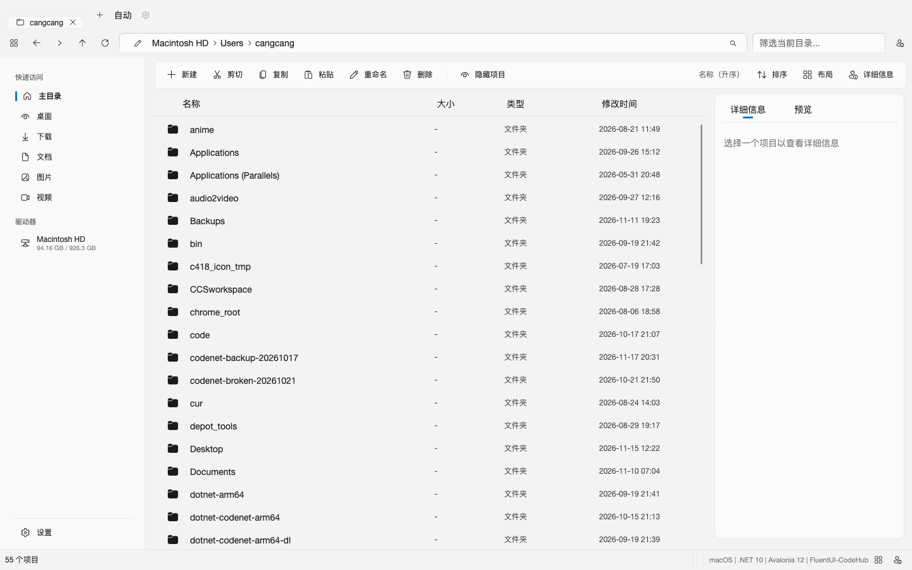

# FileHub

[](https://github.com/Hub-code-develop/FileHub/actions/workflows/build.yml)

[Chinese README (中文版说明)](README.zh-CN.md)

A cross-platform file manager built with **.NET 10 + Avalonia 12 + FluentUI-CodeHub
(`CodeHub-FluentUI`)**. Its user interface is **ported from**
[Files App](https://github.com/files-community/Files), the WinUI 3 file manager for Windows.

This English file is the primary README. The Chinese translation is
[README.zh-CN.md](README.zh-CN.md). Documentation defaults to English; the application UI does
not (see [UI language](#ui-language)).



## Attribution: code ported from Files

**The UI of FileHub is a port of [Files](https://github.com/files-community/Files), not merely
an imitation.** Its XAML layout structure was carried over from that repository and re-expressed
with Avalonia controls.

| Files source (MIT) | Ported to in FileHub |
| --- | --- |
| `src/Files.App/Views/MainPage.xaml` | `src/FileHub.Desktop/Views/MainWindow.axaml` root grid |
| `src/Files.App.Controls/Sidebar/SidebarView.xaml` | `Views/Controls/FilesSidebar.axaml(.cs)` — header / items / footer |
| `src/Files.App/UserControls/NavigationToolbar.xaml` | `Views/Controls/FilesNavigationToolbar.axaml(.cs)` — 48px, 36x32 buttons |
| `src/Files.App/UserControls/Toolbar.xaml` | `Views/Controls/FilesToolbar.axaml(.cs)` — 8px card, buttons built from the command registry |
| `src/Files.App/UserControls/TabBar/TabBar.xaml` | `WinTabStrip` tab strip (32px tabs, footer actions) |
| `src/Files.App/UserControls/StatusBar.xaml` | `Views/Controls/FilesStatusBar.axaml(.cs)` — 32px, 1x18 dividers |
| `src/Files.App/UserControls/Pane/InfoPane.xaml` | `Views/Controls/FilesInfoPane.axaml(.cs)` — 300px pane, tab pills |
| `src/Files.App/Views/Layouts/DetailsLayoutPage.xaml` | `Views/Controls/DetailsLayoutPage.axaml(.cs)` — 40px header, 34/*/110/150/160 columns |
| `src/Files.App/Actions/IAction.cs`, `BaseUIAction.cs`, `Data/Commands/Manager/CommandManager.cs` | `src/FileHub.Desktop/Actions/` — `CommandCodes`, `IRichCommand`, `RichCommand`, `CommandManager` |
| `src/Files.App/Styles/TabBarStyles.xaml` | `src/FileHub.Desktop/Styles/FileHubTheme.axaml` |

What came across: the shell skeleton (tab strip, grouped sidebar with quick access and drives,
navigation toolbar, command bar, file area with a toggleable details pane, status bar), the
command groupings (Layout / Sort / Details pane / Hidden items), and the concrete layout
numbers (row heights, column widths, corner radii, paddings, spacing).

What did not come across: WinUI 3 does not run on Avalonia, so every control was mapped to a
CodeHub-FluentUI or Avalonia equivalent, and Files-only infrastructure (Shell COM, `x:Bind`,
`ThemeResource`, WinRT storage, `ItemsRepeater`) was replaced by FileHub view models and the
cross-platform `FileSystemService`. Files' command bodies depend on WinRT/Win32 and cannot run
on macOS or Linux; the command *structure* (identifier enum, registry, rich command objects)
was ported, while the bodies call FileHub's cross-platform services.

**Files is MIT licensed, and because its layout code was ported the original copyright and
permission notice are reproduced in full in [THIRD-PARTY-NOTICES.md](THIRD-PARTY-NOTICES.md).**
That file also lists every other third-party component.

FileHub itself is released under the [MIT License](LICENSE).
Thanks to the Files Community for a genuinely well-designed file manager.

## Attribution: control styles ported from WinUI 3

`src/WinUI3.Fluent/` is a **from-source port of the WinUI 3 default control styles**
([microsoft/microsoft-ui-xaml](https://github.com/microsoft/microsoft-ui-xaml), MIT). The
upstream style definitions ship as plain-text XAML, so every colour, corner radius, padding and
state colour in that project was copied from
`controls/dev/CommonStyles/*_themeresources.xaml` rather than eyeballed from screenshots.

| WinUI 3 source (MIT) | Ported to in FileHub |
| --- | --- |
| `Common_themeresources_any.xaml` | `src/WinUI3.Fluent/Themes/Tokens.axaml` — light and dark colour palettes |
| `CornerRadius_themeresources.xaml` | `Tokens.axaml` — `ControlCornerRadius` 4, `OverlayCornerRadius` 8 |
| `Button_themeresources.xaml` | `Themes/Button.axaml` — 32px height, `11,5,11,6` padding, accent and subtle variants |
| `ToggleButton_themeresources.xaml` | `Themes/ToggleButton.axaml` |
| `CheckBox_themeresources.xaml` | `Themes/CheckBox.axaml` — 20px box, 8px label gap |
| `RadioButton_themeresources.xaml` | `Themes/RadioButton.axaml` — accent disc plus on-accent dot |
| `ListViewItem_themeresources.xaml` | `Themes/ListBoxItem.axaml` — hover surface and 3x16 selection pill |
| `TextBox_themeresources.xaml` | `Themes/TextBox.axaml` — 32px, `10,5,6,6` padding, accent underline on focus |
| `ToggleSwitch_themeresources.xaml` | `Themes/ToggleSwitch.axaml` — 40x20 track, 12px knob |
| `ToolTip_themeresources.xaml`, `FlyoutPresenter_themeresources.xaml` | `Themes/Surfaces.axaml` |
| `TabView` / `TabViewItem` | `Themes/TabStrip.axaml` + `Controls/WinTabStrip.cs` — 32px tab, `8,8,0,0` corners |
| `AppBarButton` / `CommandBar` | `Themes/AppBarButton.axaml` + `Controls/WinAppBarButton.cs` — 48px row, `2,6` inner inset, 12px label |

### Control coverage

| Control | Status |
| --- | --- |
| Button, ToggleButton, CheckBox, RadioButton, ToggleSwitch, TextBox, TextBlock | Ported |
| AppBarButton (command bar buttons) | Ported |
| ListBoxItem / ListViewItem | Ported |
| ToolTip, FlyoutPresenter | Ported |
| TabView (tab strip) | Ported, including the close button |
| ScrollBar | Inherited — see below |
| NavigationView, BreadcrumbBar, InfoBar, ProgressRing, MenuFlyout, ComboBox | Served by CodeHub-FluentUI |

`ScrollBar` is the one deliberate omission. Avalonia's `ScrollBar` takes ownership of
`PART_Track` in `OnApplyTemplate` and derives the thumb from `ViewportSize`; copying WinUI's
template through verbatim collapses the thumb to a dot. A working Fluent scroll bar beats a
faithful broken one.

The port is deliberately honest about its limits: Acrylic and Mica are Windows compositor
backdrops with no portable equivalent, and Segoe UI Variable is not licensed for redistribution.
A WinUI 3 window and this port therefore differ in font rendering and translucency, not in
control geometry. Full detail in [THIRD-PARTY-NOTICES.md](THIRD-PARTY-NOTICES.md).

`CodeHub-FluentUI` is a separate dependency from
[`Hub-code-develop/CodeHub-FluentUI`](https://github.com/Hub-code-develop/CodeHub-FluentUI)
(MIT); its offline package is described in [local-feed/README.md](local-feed/README.md).

## UI language

The application detects the **operating system language at startup**. English is never a
hard-coded default for the UI. A Chinese system shows Chinese; an English system shows English.

Detection order (first usable signal wins):

| Platform | Signal |
| --- | --- |
| macOS | `defaults read -g AppleLanguages`, then `AppleLocale` |
| Windows | `CultureInfo.InstalledUICulture` |
| Linux / Unix | `LC_ALL`, then `LC_MESSAGES`, then `LANG` (`C`, `POSIX`, `C.UTF-8` are skipped because they carry no language) |
| Any | `CultureInfo.CurrentUICulture` as a last resort |

The macOS preference is queried first on purpose: a GUI app launched from Finder inherits no
`LC_*` variables, so reading `AppleLanguages` is the only reliable way to get the user's real
language. The tooltip on the language button shows which signal was used, for example
`zh-Hans-CN / macOS AppleLanguages`.

- `FILEHUB_LANG=en`, `FILEHUB_LANG=zh-CN` or `FILEHUB_LANG=auto` overrides detection for a
  single run. `auto` restores OS detection.
- The in-app language button cycles **Auto -> English -> Chinese -> Auto**. A manual choice is
  only kept for the current session; the next launch follows the OS again.
- English and Simplified Chinese are the two available translations. Any other locale falls back
  to English only because no translation exists for it yet, not because English is preferred.
- Only documentation defaults to English. Every user-visible string in the app has both English
  and Chinese values in `Services/LocalizationService.cs`.

## Tech stack

| Component | Version / source |
| --- | --- |
| .NET | `net10.0` (SDK 10.0.400) |
| Avalonia | 12.1.0 |
| UI style library | `CodeHub-FluentUI` `3.1.0-codehub.1` (bundled offline feed in `local-feed/`) |
| Theme | `FluentAvaloniaTheme` (`FluentAvalonia.Styling`) |

FluentUI-CodeHub widgets used: `FANavigationView` (sidebar), `FABreadcrumbBar` (path),
`FAContentDialog` (new / rename / delete confirmation / properties), `FAInfoBar` (feedback),
`FAProgressRing` and `FASkeleton` (loading state, the latter is specific to the CodeHub fork),
`FAMenuFlyout` / `FAMenuFlyoutItem` (context menu), `FASymbolIcon` / `FASymbolIconSource` (icons).

## Features

- Sidebar lists platform quick access (Home, Desktop, Downloads, Documents, Pictures, Videos)
  and mounted drives
- Back / Forward / Up / Refresh with navigation history
- Breadcrumb path plus an editable address bar (`~` supported)
- Details view (Name / Size / Type / Date modified, click a column header to sort) and icon grid view
- **Image thumbnails and file previews**: JPG / PNG / GIF / BMP / WebP / TIFF show a decoded
  thumbnail in both views; selecting a file shows a large image preview or a text prefix in the
  details pane. The pane's **Details** / **Preview** tabs switch between properties and the
  full preview. Unsupported formats fall back to a category icon.
- Live filtering plus recursive search (300 result limit, cancellable)
- File operations: open, reveal in system file manager, new folder, rename, copy / cut / paste,
  copy path, properties
- **Drag and drop**: drag selected items onto a folder row, a breadcrumb segment or a sidebar
  location to move them; hold Ctrl to copy instead. Dropping files from Finder / Explorer
  imports them as a copy. Name collisions are resolved with a numeric suffix, never overwritten
- **Live directory watcher**: external creates, deletes and renames in the current folder refresh
  the list automatically (coalesced, 280 ms debounce), preserving the current selection. Manual
  refresh (F5) remains available for volumes that cannot be watched
- **Delete always moves items to the recycle bin** (Windows Shell, macOS `~/.Trash`, Linux
  `gio trash`). Nothing is silently deleted permanently
- Multiple tabs, each with its own path and history
- Multi-select, hidden items toggle, light / dark / system theme, status bar statistics
- Full keyboard shortcuts

| Shortcut | Action | Shortcut | Action |
| --- | --- | --- | --- |
| `Alt+Left` / `Alt+Right` | Back / Forward | `F2` | Rename |
| `Backspace` | Up one level | `F5` | Refresh |
| `Ctrl/Cmd+C` / `X` / `V` | Copy / Cut / Paste | `Delete` | Move to recycle bin |
| `Ctrl/Cmd+A` | Select all | `Enter` | Open selection |
| `Ctrl/Cmd+F` | Focus search | `Ctrl/Cmd+L` | Edit path |
| `Esc` | Clear search / leave path editing | Double-click | Open |

## Build and run

Everything restores without configuration: the `CodeHub-FluentUI` nupkg is committed in
`local-feed/` and `NuGet.Config` points at it with a relative path. No machine-specific path is
needed after cloning.

```bash
./build.sh
./build.sh -c Release          # any dotnet build arguments are passed through
dotnet run --project src/FileHub.Desktop/FileHub.Desktop.csproj
```

`build.sh` applies resource guards (`nice -n 20`, `-m:2`, `-nodeReuse:false`) and picks an SDK in
this order:

1. `FILEHUB_DOTNET` environment variable
2. `$HOME/dotnet11x64/dotnet` (if present)
3. `dotnet` on `PATH`

On a normal machine, the official .NET 10 SDK is enough. The two environment issues below are
specific to the author's machine and explain the extra MSBuild target.

### Why `FileHubCompileAvaloniaXaml` exists

The CodeNet **arm64** .NET 10.0.400 SDK comments out
`CallTarget Targets="$(TargetsTriggeredByCompilation)"` in
`Microsoft.CSharp.CurrentVersion.targets`, which is the hook that runs Avalonia 12's
`CompileAvaloniaXaml`. The result is a build with 0 errors whose output still contains raw XAML,
so the app fails at runtime with `No precompiled XAML found for FileHub.Desktop.App`.

`src/FileHub.Desktop/FileHub.Desktop.csproj` calls the target explicitly with
`AfterTargets="CoreCompile"`, so XAML is compiled with any SDK. Avalonia 12.1 enables compiled
bindings by default; this project uses reflection bindings, so it sets
`AvaloniaUseCompiledBindingsByDefault=false`. MSBuild runs a target only once per build, so the
official SDK (which has the hook) does not compile XAML twice; CI uses the official SDK safely.

Known environment limitation: the **arm64 CodeNet SDK SIGSEGVs (139)** inside that XAML compiler
task. The official arm64 SDK or the x64 SDK both work; the x64 SDK was measured at about 7 s with
0 warnings and 0 errors.

### Offline feed

`CodeHub-FluentUI 3.1.0-codehub.1` comes from
[`Hub-code-develop/CodeHub-FluentUI`](https://github.com/Hub-code-develop/CodeHub-FluentUI)
(MIT) and is not on nuget.org. Its 1.1 MB nupkg is committed so the repository is self-contained.
See `local-feed/README.md` for upgrade instructions. The package requires Avalonia 12.1.0 /
net10.0, so do not change those versions independently.

## GitHub Actions

`.github/workflows/build.yml` runs on pushes to `main`, pull requests and manual dispatch:

| Runner | RID | Steps |
| --- | --- | --- |
| `ubuntu-latest` | `linux-x64` | restore, Release build, RID restore, publish, XAML gate, upload artifact |
| `windows-latest` | `win-x64` | same |
| `macos-latest` | `osx-arm64` | same |

- `actions/setup-dotnet@v4` installs the SDK from `global.json` (10.0.400); no secrets needed
- `dotnet restore --configfile NuGet.Config` uses the bundled `local-feed/`; no private feed or token
- Solution-level `dotnet build` rejects `-r` (NETSDK1134), so the RID is only applied to the
  single-project publish. A framework-dependent RID publish is about **31 MB**; without a RID
  it flattens to 564 MB, mostly Windows `.pdb` files
- **XAML gate**: `publish/FileHub.dll` must contain `!XamlIlPopulate`, which catches the
  "0 errors but no precompiled XAML" failure mode
- Each platform uploads a `FileHub-<rid>-net10.0` artifact (retained for 14 days)

## Structure

```text
FileHub/
├── .github/workflows/     build.yml (three-platform CI)
├── FileHub.slnx           solution
├── global.json            SDK 10.0.400
├── NuGet.Config           nuget.org + bundled offline feed
├── local-feed/            CodeHub-FluentUI nupkg (MIT)
├── LICENSE                MIT
├── build.sh               build script with resource guards
├── README.md              this file (English, primary)
├── README.zh-CN.md        Chinese README
└── src/
    ├── FileHub.Files/     logic only, no UI dependency, unit-testable
    │   ├── Models/        FileEntry / LocationEntry
    │   └── Services/      FileSystemService / RecycleBinService / PlatformService / FileClipboard / PreviewService / DirectoryWatcherService
    └── FileHub.Desktop/   Avalonia application
        ├── App.axaml      theme entry point
        ├── Styles/        application styles
        ├── ViewModels/    ShellViewModel (tabs) / MainViewModel (one tab) / commands
        ├── Views/         MainWindow / Views/Controls (Files App layout ports)
        └── Services/      LocalizationService (en + zh-CN) / DialogService (FAContentDialog) / ThumbnailService / DragDropPayload
```

## Verification

- `build.sh`: 0 warnings, 0 errors; XAML compiled into `FileHub.dll` (`!XamlIlPopulate` present)
- Headless (no GUI window) verification: `App.axaml` + `FluentAvaloniaTheme` +
  `avares://FileHub/Styles/AppStyles.axaml` load, every MainWindow control instantiates,
  home directory enumerates 55 items / 7 locations / 3 breadcrumb segments, filtering
  55 -> 0 -> 55 works
- Language detection verified under four environment configurations (unset, `auto`, `en`,
  `zh-CN`), including the three-state in-app language cycle
- Preview verification (headless Skia): Pictures folder decodes 7/7 image thumbnails; selecting
  an image produces a 512px pane bitmap in both Details and Preview tabs; selecting `README.md`
  produces a 4004-character text preview starting with `# FileHub`
- Drag-and-drop verification (headless): move 2 files into a folder, copy back with the source
  kept, folder-into-itself rejected, name collisions renamed not overwritten, payload round-trip
- Watcher verification: 12 burst writes produce one coalesced callback; end-to-end 3 external
  creates grow the list 1 -> 4 with selection preserved, external delete refreshes too
- A fresh clone from GitHub restores and builds with no manual setup

## Known limitations

- Some virtual / network volumes cannot raise change events; F5 manual refresh still works there
- Recursive search has a fixed 300 item limit to keep large trees under control
- Thumbnails cover common bitmap formats via Avalonia's Skia decoder; SVG, HEIC and video
  thumbnails need platform codecs and currently use the category icon instead
- Copy / move uses an in-app clipboard; only "copy path" writes to the system clipboard
- Chinese variants (Traditional, Cantonese, ...) currently share the Simplified Chinese strings

## License

[MIT](LICENSE) - Copyright (c) 2026 Hub-code-develop. FileHub is a derived work: its
file-browsing UI and command structure were ported from Files App and WinUI 3 (both MIT).
When redistributing FileHub, in source or binary form, include
[THIRD-PARTY-NOTICES.md](THIRD-PARTY-NOTICES.md) alongside `LICENSE`; the upstream copyright
and permission notices are reproduced there verbatim as the MIT License requires.
