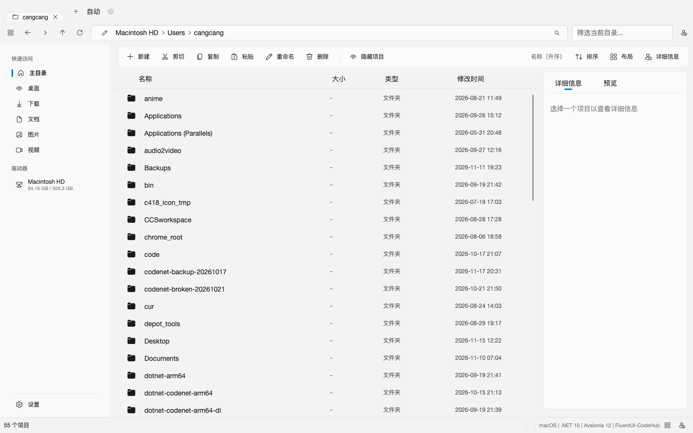

# FileHub

[](https://github.com/Hub-code-develop/FileHub/actions/workflows/build.yml)

[English README (primary)](README.md)

用 **.NET 10 + Avalonia 12 + FluentUI-CodeHub（`CodeHub-FluentUI`）** 写的跨平台文件管理器，
界面**移植自** Windows 上的 [Files App](https://github.com/files-community/Files)（WinUI 3 文件管理器）。

主说明文件是英文的 [README.md](README.md)，本文件是中文翻译。
**文档默认英文；应用界面不会默认英文**，详见[界面语言](#界面语言)。



## 版权与来源声明：移植自 Files 的代码

**FileHub 的界面是把 [Files](https://github.com/files-community/Files) 的 XAML 布局移植过来的，
不只是"模仿"。** 它把该仓库的布局结构取了过来，再用 Avalonia 控件重新表达。

| Files 源文件（MIT） | 移植到 FileHub 的位置 |
| --- | --- |
| `src/Files.App/Views/MainPage.xaml` | `src/FileHub.Desktop/Views/MainWindow.axaml` 根 Grid |
| `src/Files.App.Controls/Sidebar/SidebarView.xaml` | `Views/Controls/FilesSidebar.axaml(.cs)`（头部 / 菜单项 / 页脚三行） |
| `src/Files.App/UserControls/NavigationToolbar.xaml` | `Views/Controls/FilesNavigationToolbar.axaml(.cs)`（高 48，按钮 36x32） |
| `src/Files.App/UserControls/Toolbar.xaml` | `Views/Controls/FilesToolbar.axaml(.cs)`（8px 卡片，按钮由命令集动态生成） |
| `src/Files.App/UserControls/TabBar/TabBar.xaml` | `WinTabStrip` 标签栏（标签高 32，尾部操作区） |
| `src/Files.App/UserControls/StatusBar.xaml` | `Views/Controls/FilesStatusBar.axaml(.cs)`（高 32，1x18 分隔线） |
| `src/Files.App/UserControls/Pane/InfoPane.xaml` | `Views/Controls/FilesInfoPane.axaml(.cs)`（宽 300，标签胶囊） |
| `src/Files.App/Views/Layouts/DetailsLayoutPage.xaml` | `Views/Controls/DetailsLayoutPage.axaml(.cs)`（列头高 40，34/*/110/150/160 列宽） |
| `src/Files.App/Actions/IAction.cs`、`BaseUIAction.cs`、`Data/Commands/Manager/CommandManager.cs` | `src/FileHub.Desktop/Actions/`（`CommandCodes`、`IRichCommand`、`RichCommand`、`CommandManager`） |
| `src/Files.App/Styles/TabBarStyles.xaml` | `src/FileHub.Desktop/Styles/FileHubTheme.axaml` |

移植过来的内容：整体骨架（顶部标签栏、侧栏分组含快速访问与驱动器、导航工具栏、命令栏、
文件区加可开关的详细信息窗格、状态栏）、命令栏分组（布局 / 排序 / 详细信息 / 隐藏项目），
以及具体的布局数值（行高、列宽、圆角、内边距、间距）。

没有移植的内容：WinUI 3 的 XAML 无法在 Avalonia 上运行，所以每个控件都映射到了
CodeHub-FluentUI 或 Avalonia 的等价控件，Files 专属的基础设施（Shell COM、`x:Bind`、
`ThemeResource`、WinRT 存储、`ItemsRepeater`）换成了 FileHub 的 ViewModel 与跨平台
`FileSystemService`。Files 的命令体依赖 WinRT/Win32，无法在 macOS/Linux 上运行；
我们移植的是命令的**结构**（标识符枚举、注册表、携带标签/图标/快捷键/可执行状态的命令对象），
命令体改为调用 FileHub 的跨平台服务。

**Files 采用 MIT 许可证，允许再分发（redistribution）。由于移植了它的布局与命令结构代码，
其原始版权声明与许可声明已完整保留在
[THIRD-PARTY-NOTICES.md](THIRD-PARTY-NOTICES.md) 中。** 再分发 FileHub（源码或二进制）时，
必须随附该文件与 `LICENSE`。该文件同时列出全部其它第三方组件。

FileHub 本身采用 [MIT 许可证](LICENSE)。感谢 Files 社区做出了一个设计确实出色的文件管理器。

`CodeHub-FluentUI` 是来自
[`Hub-code-develop/CodeHub-FluentUI`](https://github.com/Hub-code-develop/CodeHub-FluentUI)
的独立依赖（MIT），离线包说明见 [local-feed/README.md](local-feed/README.md)。

## 控件层：从 WinUI 3 源码移植

`src/WinUI3.Fluent/` 是 **直接照 WinUI 3 默认控件样式源码移植**的（
[microsoft/microsoft-ui-xaml](https://github.com/microsoft/microsoft-ui-xaml)，MIT）。
WinUI 3 的样式是明文 XAML，所以颜色、圆角、内边距、各状态配色都是照抄
`controls/dev/CommonStyles/*_themeresources.xaml`，不是照截图用眼睛调出来的。

| 控件 | 状态 |
| --- | --- |
| Button、ToggleButton、CheckBox、RadioButton、ToggleSwitch、TextBox、TextBlock | 已移植 |
| ListBoxItem / ListViewItem | 已移植 |
| ToolTip、FlyoutPresenter | 已移植 |
| TabView 标签栏（含关闭按钮） | 已移植（`WinTabStrip`） |
| AppBarButton（命令栏按钮） | 已移植（`WinAppBarButton`） |
| ScrollBar | 沿用库自带实现 |
| NavigationView、BreadcrumbBar、InfoBar、ProgressRing、MenuFlyout、ComboBox | 由 CodeHub-FluentUI 提供 |

`ScrollBar` 是唯一刻意不移植的：Avalonia 的 `ScrollBar` 在 `OnApplyTemplate` 里接管
`PART_Track`，滑块比例来自 `ViewportSize`，照搬 WinUI 模板会让滑块退化成一个小圆点。
宁可用能滚动的原生滚动条，也不交付一个长得像但坏掉的。

无法做到一致的三处：Acrylic / Mica（Windows 合成器背景，无可移植对应物）、
Segoe UI Variable（无再分发授权）、Composition 弹簧动画（用插值过渡近似）。
逐文件映射表在 [THIRD-PARTY-NOTICES.md](THIRD-PARTY-NOTICES.md)。

## 界面语言

**应用在启动时自动检测操作系统语言**，界面不把英文写死成默认值：中文系统显示中文，
英文系统显示英文。检测顺序（取第一个有效信号）：

| 平台 | 信号 |
| --- | --- |
| macOS | `defaults read -g AppleLanguages`，其次 `AppleLocale` |
| Windows | `CultureInfo.InstalledUICulture` |
| Linux / Unix | `LC_ALL`、`LC_MESSAGES`、`LANG`（`C` / `POSIX` / `C.UTF-8` 不含语言信息，跳过） |
| 通用兜底 | `CultureInfo.CurrentUICulture` |

macOS 优先读系统语言偏好是故意的：从 Finder 启动的 GUI 应用不继承任何 `LC_*` 变量，
只有读 `AppleLanguages` 才能拿到用户真正的语言。语言按钮的提示里会显示实际用的信号，
例如 `zh-Hans-CN / macOS AppleLanguages`。

- `FILEHUB_LANG=en` / `zh-CN` / `auto` 可单次运行覆盖检测结果，`auto` 表示恢复跟随系统
- 界面语言按钮依次切换 **自动 / English / 中文 / 自动**。手动选择只在本次运行有效，
  下次启动仍跟随系统
- 目前提供英文与简体中文两套文案。其它语言回退到英文，仅仅是因为尚无对应翻译，
  不是因为默认偏好英文
- 只有文档默认英文。应用里每一条用户可见文案都在
  `Services/LocalizationService.cs` 中同时有英文和中文值

## 技术栈

| 组件 | 版本 / 来源 |
| --- | --- |
| .NET | `net10.0`（SDK 10.0.400） |
| Avalonia | 12.1.0 |
| UI 样式库 | `CodeHub-FluentUI` `3.1.0-codehub.1`（仓库自带离线源 `local-feed/`） |
| 主题 | `FluentAvaloniaTheme`（`FluentAvalonia.Styling`） |

用到的 FluentUI-CodeHub 控件：`FANavigationView`（侧栏）、`FABreadcrumbBar`（路径）、
`FAContentDialog`（新建 / 重命名 / 删除确认 / 属性）、`FAInfoBar`（操作反馈）、
`FAProgressRing` + `FASkeleton`（加载态，后者是 CodeHub 分支特有控件）、
`FAMenuFlyout` / `FAMenuFlyoutItem`（右键菜单）、`FASymbolIcon` / `FASymbolIconSource`（图标）。

## 功能

- 侧栏按平台自动列出主目录 / 桌面 / 下载 / 文档 / 图片 / 视频，以及当前已挂载卷
- 前进 / 后退 / 上一级 / 刷新，带导航历史
- 面包屑路径 + 可编辑地址栏（支持 `~`）
- 详细信息视图（名称 / 大小 / 类型 / 修改时间，点列头排序）与图标网格视图切换
- 即时筛选 + 递归搜索（结果上限 300，可取消）
- 文件操作：打开、在系统文件管理器中显示、新建文件夹、重命名、复制 / 剪切 / 粘贴、复制路径、属性
- **删除一律移到回收站**（Windows Shell / macOS `~/.Trash` / Linux `gio trash`），绝不静默永久删除
- 多标签页，每个标签有独立的路径与历史
- 多选、隐藏文件开关、浅色 / 深色 / 跟随系统主题、状态栏统计
- 快捷键齐全

| 快捷键 | 动作 | 快捷键 | 动作 |
| --- | --- | --- | --- |
| `Alt+Left` / `Alt+Right` | 后退 / 前进 | `F2` | 重命名 |
| `Backspace` | 上一级 | `F5` | 刷新 |
| `Ctrl/Cmd+C` / `X` / `V` | 复制 / 剪切 / 粘贴 | `Delete` | 移到回收站 |
| `Ctrl/Cmd+A` | 全选 | `Enter` | 打开选中项 |
| `Ctrl/Cmd+F` | 聚焦搜索 | `Ctrl/Cmd+L` | 编辑路径 |
| `Esc` | 清除搜索 / 退出路径编辑 | 双击 | 打开 |

## 构建与运行

依赖全部可还原：`CodeHub-FluentUI` 的 nupkg 已放在 `local-feed/`，根目录 `NuGet.Config`
用相对路径引用它，clone 后无需配置任何本机路径。

```bash
./build.sh
./build.sh -c Release          # 透传任意 dotnet build 参数
dotnet run --project src/FileHub.Desktop/FileHub.Desktop.csproj
```

`build.sh` 带资源护栏（`nice -n 20`、`-m:2`、`-nodeReuse:false`），并按下述优先级挑 SDK：

1. 环境变量 `FILEHUB_DOTNET`
2. `$HOME/dotnet11x64/dotnet`（若存在）
3. PATH 里的 `dotnet`

普通机器上直接用官方 .NET 10 SDK 即可；下面两个环境级问题只出现在作者机器上，
也是项目里多写一个 MSBuild target 的原因。

### 为什么有 `FileHubCompileAvaloniaXaml` 这个 target

CodeNet **arm64** SDK（10.0.400）把 `Microsoft.CSharp.CurrentVersion.targets` 里
`CallTarget Targets="$(TargetsTriggeredByCompilation)"` 整段注释掉了，而 Avalonia 12 的
`CompileAvaloniaXaml` 正是靠这个钩子触发。后果是：构建显示 0 错误，产物里却只有原始 XAML，
运行时报 `No precompiled XAML found for FileHub.Desktop.App`。

`src/FileHub.Desktop/FileHub.Desktop.csproj` 里加了 `AfterTargets="CoreCompile"` 的显式调用，
换任何 SDK 都会编译 XAML。另外 Avalonia 12.1 默认开启编译绑定，本项目用反射绑定，
所以显式设了 `AvaloniaUseCompiledBindingsByDefault=false`。MSBuild 保证同一 Target 在一次
构建中只执行一次，官方 SDK 自带钩子也不会二次编译，CI 走官方 SDK 是安全的。

注意，已知环境限制：**arm64 CodeNet SDK 在执行 XAML 编译任务时会 SIGSEGV(139)**。
官方 arm64 SDK 或 x64 SDK 均可，作者机器上实测 x64 SDK 约 7 秒 / 0 警告 0 错误。

### 关于 `local-feed/`

`CodeHub-FluentUI 3.1.0-codehub.1` 源自
[`Hub-code-develop/CodeHub-FluentUI`](https://github.com/Hub-code-develop/CodeHub-FluentUI)（MIT），
未发布到 nuget.org。为了让仓库自包含，把 1.1 MB 的 nupkg 一并提交。
详见 `local-feed/README.md`；若该包日后上了 nuget.org，删掉 `NuGet.Config` 里的
`codehub-local` 与这个目录即可。包依赖 Avalonia 12.1.0 / net10.0，版本不要单独改。

## GitHub Actions

`.github/workflows/build.yml` 在 push 到 `main`、PR 和手动触发时跑三平台矩阵：

| Runner | RID | 流程 |
| --- | --- | --- |
| `ubuntu-latest` | `linux-x64` | 还原、Release 构建、RID 还原、publish、XAML 门禁、上传 artifact |
| `windows-latest` | `win-x64` | 同上 |
| `macos-latest` | `osx-arm64` | 同上 |

- SDK 由 `actions/setup-dotnet@v4` 按 `global.json`（10.0.400）安装，不需要任何密钥
- `dotnet restore --configfile NuGet.Config` 显式使用仓库自带的 `local-feed/`，不需要私有源或 token
- 解决方案级 `dotnet build` 不接受 `-r`（NETSDK1134），所以 RID 只加在单项目 `dotnet publish`；
  带 RID 的 framework-dependent publish 约 **31 MB**（不带 RID 会摊平成 564 MB，大半是 Windows 的 `.pdb`）
- **XAML 门禁**：检查 `publish/FileHub.dll` 必须含 `!XamlIlPopulate`，
  防止「构建 0 错误但 XAML 没预编译」再次溜过去
- 每个平台上传 `FileHub-<rid>-net10.0` artifact（保留 14 天）

## 结构

```text
FileHub/
├── .github/workflows/     build.yml（三平台 CI）
├── FileHub.slnx           解决方案
├── global.json            SDK 10.0.400
├── NuGet.Config           nuget.org + 仓库内离线源
├── local-feed/            CodeHub-FluentUI 的 nupkg（MIT）
├── LICENSE                MIT
├── build.sh               带资源护栏的构建脚本
├── README.md              英文主说明
├── README.zh-CN.md        本文件（中文说明）
└── src/
    ├── FileHub.Files/     纯逻辑，无 UI 依赖，可单测
    │   ├── Models/        FileEntry / LocationEntry
    │   └── Services/      FileSystemService / RecycleBinService / PlatformService / FileClipboard
    └── FileHub.Desktop/   Avalonia 应用
        ├── App.axaml      主题入口
        ├── Styles/        应用样式
        ├── ViewModels/    ShellViewModel（标签）/ MainViewModel（单个标签）/ 命令
        ├── Views/         MainWindow
        └── Services/      LocalizationService（英中双语）/ DialogService（FAContentDialog 封装）
```

## 验证情况

- `build.sh`：0 警告 0 错误，XAML 已编译进 `FileHub.dll`（可见 `!XamlIlPopulate`）
- 无窗口 headless 验证：`App.axaml` + `FluentAvaloniaTheme` +
  `avares://FileHub/Styles/AppStyles.axaml` 加载成功；`MainWindow.axaml` 全部控件实例化成功；
  主目录枚举 55 项 / 7 个位置 / 3 段面包屑；筛选 55 到 0 到 55 正常
- 语言检测在四种环境下验证（未设置、`auto`、`en`、`zh-CN`），含界面三态切换
- 从 GitHub 全新 clone 后可直接还原并构建，无需手工配置

## 已知限制 / 后续可加

- 没有拖拽移动、缩略图预览、文件监视（目录变化需手动刷新）
- 递归搜索固定 300 项上限，避免在大目录里失控
- 复制 / 移动为应用内剪贴板，不写系统剪贴板（只有复制路径会写）
- 繁体中文、粤语等中文变体目前共用简体中文文案

## 许可证

[MIT](LICENSE) - Copyright (c) 2026 Hub-code-develop。Files App 的完整声明（界面布局移植自该项目）
以及全部第三方组件说明见 [THIRD-PARTY-NOTICES.md](THIRD-PARTY-NOTICES.md)。
